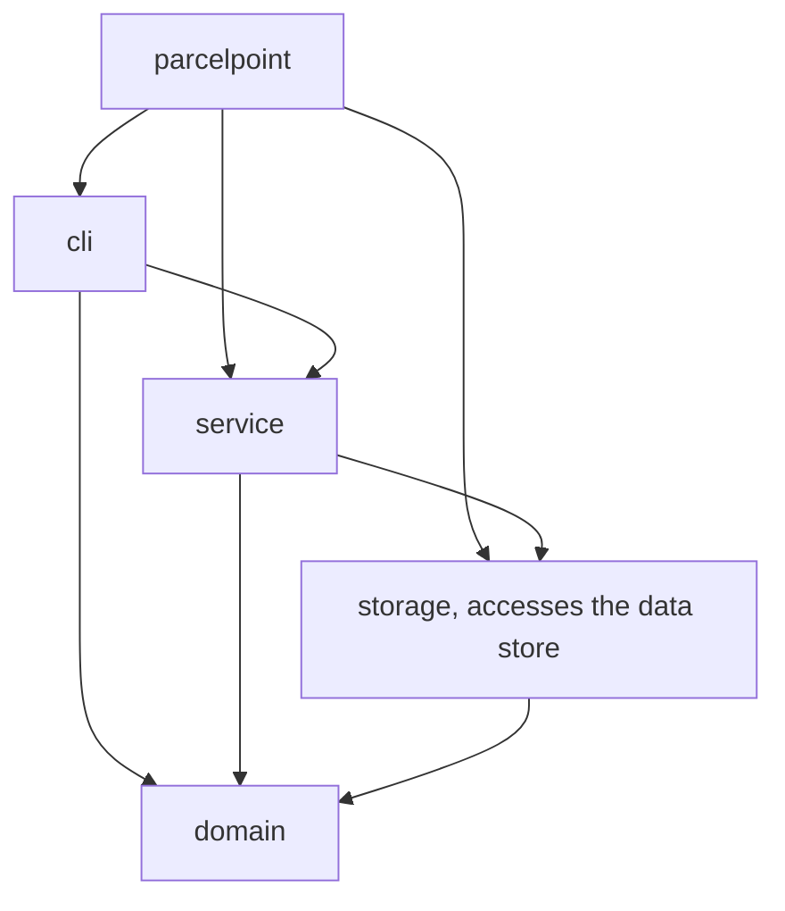
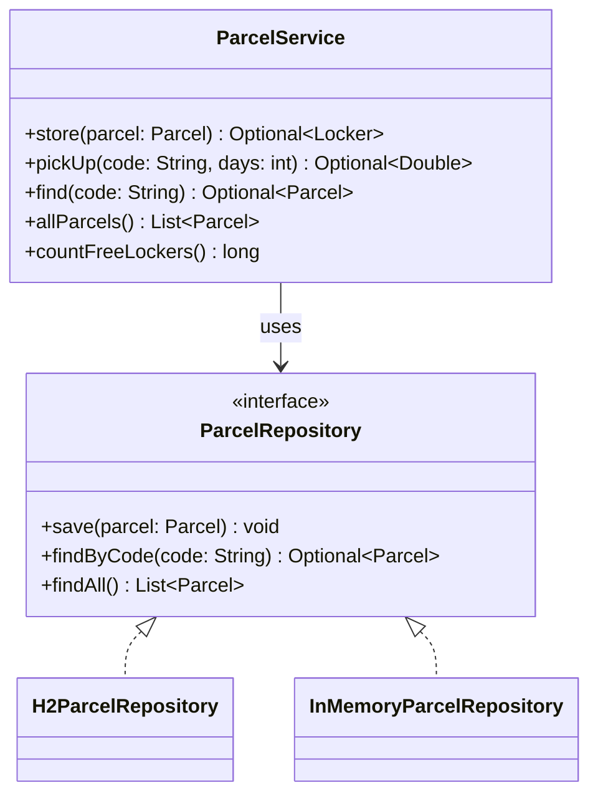
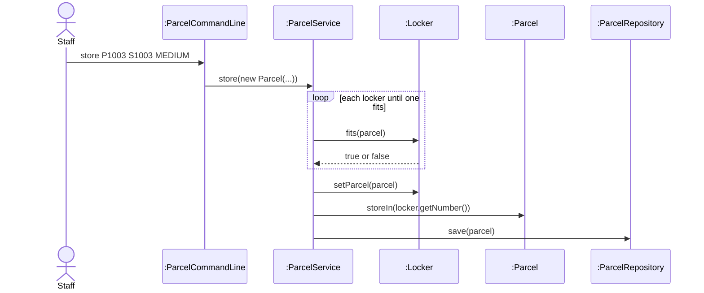

# Lab Report, Designing the Data Management Layer with H2

Repository URL: https://github.com/boncedy/itcs382-h2-lab 

## Tools

| Item | Version or name |
| --- | --- |
| JDK | 1.8.0_511 |
| Maven | 3.10.0 |
| IDE | git 2.56.0.windows.2 |
| AI tool and exact model, if you used one | |

## Part 0. From a store in memory to H2

Commit of the starter, before any change:

0.3 Your prediction for `staff`, written before the second run:

Output of the second run, for `staff` and `quit`:

```
Free lockers: 3
- I think they're kept temporarily in InMemoryParcelRepository.java because they're mapped in the memory, and when I exited the program, they're free and we won't see the same parcels again.
```

State in one sentence where you think the parcels of the first run were kept.

0.5 The line of Main that you would change to keep the parcels somewhere else:

```
ParcelRepository repository = new InMemoryParcelRepository();
```

0.6 Commit of the switch to H2:
```
1. import parcelpoint.storage.H2ParcelRepository;
2. ParcelRepository repository = new H2ParcelRepository("./data/parcelpoint");
```

0.7 Output of `SELECT * FROM PARCEL;` after you stored two parcels:

```
CODE  | STUDENT_ID | PARCEL_SIZE | STATUS | LOCKER_NUMBER
P1001 | S1001      | SMALL       | STORED | 1
P1002 | S1002      | LARGE       | STORED | 3
(2 rows, 13 ms)
```

0.8 Explain why ParcelPoint could not start while the H2 Shell was open, and identify the class that wrote the message `Cannot create the PARCEL table`.
```
The Shell in the first terminal still holds the database open. An embedded database belongs to the 
program that opened it, so H2 locks the file parcelpoint.mv.db, and a second program cannot open it 
at the same time.
```

0.9 Explain why `staff` shows no parcel while `find` shows each one, and why all three lockers look free.
```
I found return List.of(); in the FindAll() method, which means 'staff' does not read the parcel from the database directly, and that's why it returns no parcel :)

```

0.11 Your findAll method:

```
@Override
    public List<Parcel> findAll() {
        String sql = "SELECT * FROM PARCEL";
        List<Parcel> parcels = new ArrayList<>();
        try (Connection connection = connect();
            PreparedStatement statement = connection.prepareStatement(sql);
            ResultSet row = statement.executeQuery()) {
            while (row.next()) {
                parcels.add(toParcel(row));
            }
        } catch (SQLException e) {
            throw new IllegalStateException("Cannot read the parcels", e);
        }
        return parcels;
    }
```

Commit that adds findAll:

0.12 Output of `SELECT * FROM PARCEL;` after the pickup:

```
CODE  | STUDENT_ID | PARCEL_SIZE | STATUS    | LOCKER_NUMBER
P1001 | S1001      | SMALL       | PICKED_UP | null
P1002 | S1002      | LARGE       | STORED    | 3
(2 rows, 13 ms)
```

0.13 Optional. Describe what `find P9999'OR'1'='1` showed while the SQL was joined from strings, and what it showed after you put the placeholder back.

## Part A. Model the design

A1 Complete the flowchart with one node for each package and one arrow for each dependency, from the package that uses to the package that is used. Mark the package that accesses the data store.



`cli` does not depend on `storage`; it uses `ParcelService`, which depends on the `ParcelRepository`
interface in `storage`. This keeps the command-line layer independent of the data store.

A2 Complete the class diagram of the data management layer with ParcelService, the interface ParcelRepository with its three operations, and the two classes that implement it.



A3 Draw a sequence diagram for the command `store P1003 S1003 MEDIUM`, from the staff member to the repository. Show each message as an operation of the class that receives it.



The service calls the `ParcelRepository` interface, not a concrete database class. `Main` supplies the H2 implementation at runtime, and the same service can instead use the in-memory implementation.

## Part B. Design questions

1. Identify the files that you changed to move from the store in memory to H2, and explain why no other class had to change. Use the terms of this course.
```
   I changed only `Main.java` in the program source: it creates an `H2ParcelRepository` instead of an `InMemoryParcelRepository`. `H2ParcelRepository.java` and the H2 dependency in `pom.xml` were already present; because `ParcelService` depends on the `ParcelRepository` interface, dependency inversion and polymorphism let either implementation provide the same operations without changing the service or CLI.
```

2. The PARCEL table stores the size of a parcel as SMALL, MEDIUM or LARGE rather than as 1, 2 or 3. Identify the type of connascence between ParcelSize and the table in each case, and explain which one is weaker.
```
   Storing `SMALL`, `MEDIUM`, and `LARGE` creates connascence of name, because the enum names and database values must match. Storing `1`, `2`, and `3` creates connascence of convention, because both sides must agree what each number stands for; connascence of name is weaker because the values are self-describing.
```

3. Project Phase 2 asks for a data store that needs no separate server. Explain why an embedded database such as H2 meets this rule, and describe the limit of an embedded database that Step 0.8 showed.
```
   H2 runs inside the application and stores its data in a local file, so no separate database server is needed. In the setup used here, the database file is locked while one program has it open, so the ParcelPoint application and H2 Shell cannot use that file at the same time.
```

4. State the data store that you would choose for your Project Phase 2 team, files or an embedded database, the requirement that drives the choice, and the package that will access it.
```
   For a project with structured, queryable records, I would choose an embedded database because it keeps data after the program ends without a separate server, and H2 can be the single external data-store library. The `storage` package would encapsulate access to it.
```

## AI usage declaration

| AI tool and exact model | Date | Purpose | Files or answers it produced or changed | How you checked its output |
| --- | --- | --- | --- | --- |
| GitHub Copilot | 14 Nov | Mermaid Diagram Completion in task A2 and A3 | LAB_REPORT.md - Part A: A2, A3 | I checked them with existing files from the created diagrams. |
||| Part B Questions Completion | LAB_REPORT.md - Part B: Q1-Q4 | I checked most of them with the lab pdf because the answers need to correspond with the instruction and lesson.
```
 I ensure these are true, and other excluded parts are completed by myself and I understand most of the work.
 ```